<h3><code>BiparJoy@github ~ $ ./contributions.sh</code></h3>

  

<h3><code>BiparJoy@github ~ $ neofetch</code></h3>
<table>
  <tr>
    <td valign="top"></td>
    <td valign="top"></td>
  </tr>
</table>

 

<h3><code>BiparJoy@github ~ $ ls ~/projects</code></h3>

| Project | What it is |
| --- | --- |
| [prism-download-manager](https://github.com/BiparJoy/prism-download-manager) | Rust download manager for Windows, macOS and Linux: up to 32 connections, browser integration, crash-safe resume |
| [plasma-ncs-visualizer](https://github.com/BiparJoy/plasma-ncs-visualizer) | The NCS visualizer as a KDE Plasma 6 widget, driven by live audio through CAVA |
| [noctalia-ncs-visualizer](https://github.com/BiparJoy/noctalia-ncs-visualizer) | The same orb as a Noctalia desktop widget: 103k GPU-drawn dots |
| [colornote-backup-decryptor-gui](https://github.com/BiparJoy/colornote-backup-decryptor-gui) | Decrypt, browse and export ColorNote Android backups (Python + Tkinter) |

